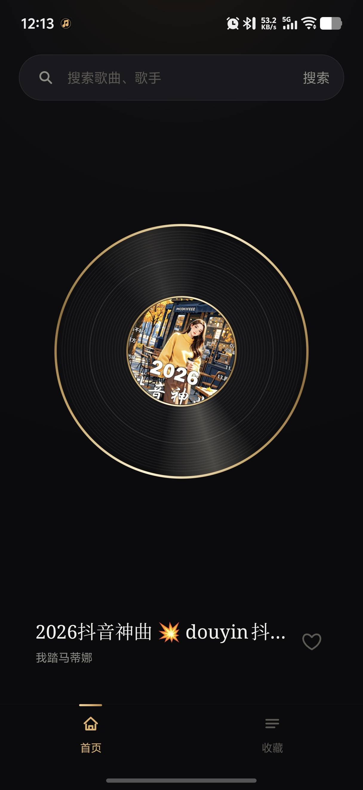
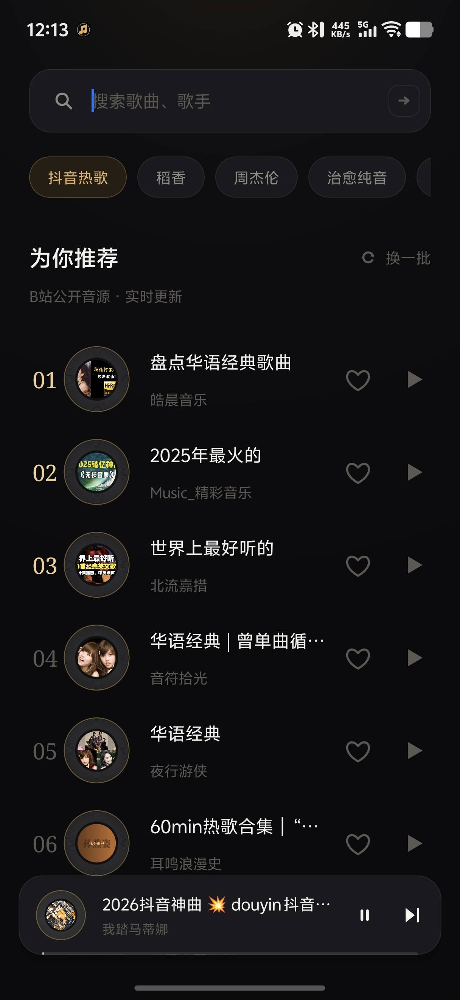
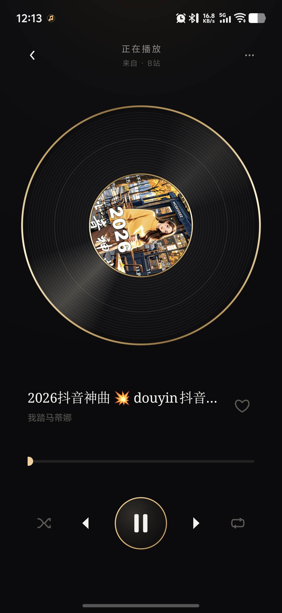
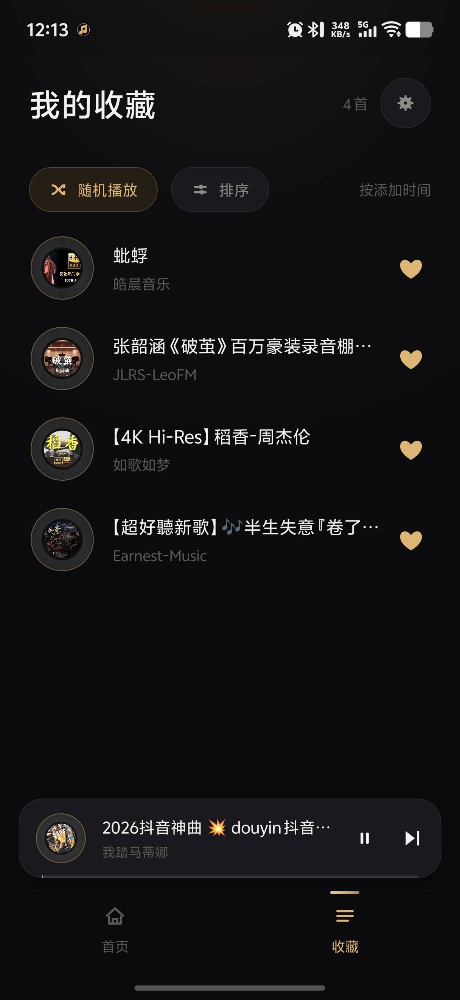

# 声搜 SoundHunt

> 一个基于 B 站公开音源的沉浸式 Android 音乐播放器。纯 Java、纯代码构建 UI，无第三方 UI 框架、无网络库、无音频内容。

**当前版本：v3.2.6（versionCode 62）** · 最低 Android 8.0（API 26） · 许可证 MIT

进入即播放推荐热歌，上下滑切歌，像刷短视频一样听歌。合集自动展开为分 P 选集，支持三档音质、相邻曲目纯音频预加载、收藏画像推荐与深浅色主题。

---

## 界面速览

以下均为 **v3.2.6 真机运行截图**（Android 模拟器 1080×1920，非设计稿渲染）：

<table align="center">
<tr>
<td align="center"><br><b>沉浸首页</b></td>
<td align="center"><br><b>搜索 / 推荐</b></td>
<td align="center"><br><b>播放页</b></td>
<td align="center"><br><b>收藏页</b></td>
</tr>
</table>

> 交互流程说明另见 [docs/DESIGN.html](docs/DESIGN.html)。

---

## 目录

- [1. 需求与背景](#1-需求与背景)
- [2. 成果概览](#2-成果概览)
- [3. 环境与构建](#3-环境与构建)
- [4. 实现原理](#4-实现原理)
- [5. 项目结构](#5-项目结构)
- [6. 已知限制](#6-已知限制)
- [7. 许可证](#7-许可证)
- [8. 免责声明](#8-免责声明)

---

## 1. 需求与背景

### 1.1 要解决的问题

做一个能装在自己手机上、打开就能听歌的播放器，但不想引入音乐版权库或付费 API。B 站上有大量公开的音乐视频与合集，可以当作音源池。围绕这个前提，有四个核心诉求：

| 诉求 | 说明 |
|---|---|
| **进入即听** | 打开 App 不要停在空白页或加载骨架，推荐流直接开播 |
| **切歌像刷短视频** | 上下滑即切歌，不需要先点进列表再点选 |
| **推荐不重复** | 不要永远推同一首、同一个歌手，要有新鲜感和探索性 |
| **弱网也能秒切** | 切歌时不要长时间转圈，提前把相邻曲目准备好 |

### 1.2 设计目标

- **零第三方依赖**：UI 全部用 `View` + `Canvas` 自绘，网络用 JDK 自带 `HttpURLConnection`，解析用 `org.json`，避免引入庞大依赖链。
- **离线可构建**：Gradle 依赖缓存后 `./gradlew assembleRelease --offline` 可用，方便无网环境交付。
- **可开源**：不含任何明文密钥、音频内容或私有服务地址，签名凭据从环境变量 / 本地属性注入。

### 1.3 明确不做的事

- 不做歌词功能：B 站字幕接口对音乐视频覆盖率接近 0，第三方曲库存在标题匹配错位和时间轴不同步，成本高收益低。
- 不做账号体系、云同步、社交：定位是单机播放器。
- 不内置任何音频文件：所有媒体均通过公开接口在线获取。

---

## 2. 成果概览

### 2.1 已实现能力

| 模块 | 成果 |
|---|---|
| 沉浸首页 | 启动自动播放推荐；上下滑切歌；轻点暂停/播放；唱片转速随音频低频律动 |
| 推荐系统 | 16 组主题词池轮转 + 并发搜索；热度/新鲜度/收藏画像/探索四信号打分；MMR 打散；跨页去重；滑到队尾自动续拉 |
| 队列管理 | 推荐 / 搜索 / 收藏三类来源标记；从任意页面回首页自动恢复推荐流；收藏页播放不跳首页 |
| 本地预加载 | 后台预下载相邻曲目的**纯音频轨**；命中即秒开；250 MB / 40 首上限，LRU 淘汰 |
| 合集选集 | 多 P 视频识别为合集；播放页展开分 P 列表选集；普通视频不误判 |
| 音源音质 | B 站搜索 + wbi 签名 + DASH 纯音频流；标准 64K / 高清 132K / 无损 FLAC 三档；多线路自动回退 |
| 界面 | 墨黑 + 琥珀暖光设计语言；深浅色双主题实时切换；全部 UI 自绘 |
| 收藏页 | 随机/顺序切换；按添加时间/歌名排序；悬浮迷你播放条；三叠卡删除后保留设置入口 |
| 播放页 | 上下滑切歌；曲目切换方向性淡入位移动画；选集弹层与进度拖动不冲突 |
| 标题清洗 | B 站脏标题去除中括号标签与营销尾巴，过短时回退原标题 |

### 2.2 交付物

| 文件 | 说明 |
|---|---|
| `app/src/main/` | 完整可编译源码（19 个 Java 文件 + 资源） |
| `releases/SoundHunt-v3.2.6.apk` | 已签名 APK，可直接安装 |
| `docs/DESIGN.html` | 交互式设计说明，浏览器打开可切深浅色 |
| `docs/screens/*.png` | 6 张界面预览图（5 页 + 浅色首页） |
| `gradlew` / `gradle/` | Gradle 8.11.1 wrapper |

### 2.3 版本信息

- `versionName`：`3.2.6`
- `versionCode`：`62`
- 签名 SHA-256：`614644…177d`（与历史版本同证书，可覆盖安装）

---

## 3. 环境与构建

### 3.1 开发环境

| 项 | 版本 / 要求 |
|---|---|
| JDK | 17（`sourceCompatibility` / `targetCompatibility` 均为 `VERSION_17`） |
| Gradle | 8.11.1（wrapper 自带，无需单独安装） |
| Android Gradle Plugin | 8.7.3 |
| compileSdk / targetSdk | 35 |
| minSdk | 26（Android 8.0） |
| 网络 | 首次构建需联网拉依赖；后续可完全离线 |

### 3.2 本地配置

```bash
cp local.properties.example local.properties
# 编辑 local.properties，把 sdk.dir 改为你的 Android SDK 路径
# 示例：sdk.dir=/home/you/Android/Sdk
```

`local.properties` 已加入 `.gitignore`，不会入库。

### 3.3 构建 Debug 包

无需任何密钥，直接可装：

```bash
./gradlew assembleDebug
# 产物：app/build/outputs/apk/debug/app-debug.apk
```

### 3.4 构建正式签名包（可选）

仓库**不含签名密钥**。要构建属于自己的正式包，二选一提供凭据：

1. 在 `local.properties` 中填写：
   ```properties
   release.storeFile=/path/to/my-release.jks
   release.storePassword=***
   release.keyAlias=mykey
   release.keyPassword=***
   ```
2. 或设置同名环境变量：
   `SOUNDHUNT_STORE_FILE` / `SOUNDHUNT_STORE_PASSWORD` / `SOUNDHUNT_KEY_ALIAS` / `SOUNDHUNT_KEY_PASSWORD`

然后执行：

```bash
./gradlew assembleRelease
# 产物：app/build/outputs/apk/release/app-release.apk
```

生成自己的密钥：

```bash
keytool -genkeypair -v -keystore my-release.jks -keyalg RSA \
        -keysize 2048 -validity 10000 -alias mykey
```

> **注意**：正式包需要同一份签名证书才能覆盖安装旧版本。换用新密钥会导致用户必须先卸载旧版。`releases/` 中的示例 APK 使用原作者密钥签名，仅用于体验，无法与本仓库自行构建的签名包互相覆盖。

### 3.5 增量构建

项目已开启 Gradle 守护进程、构建缓存与并行执行（见 `gradle.properties`）：

```properties
org.gradle.daemon=true
org.gradle.caching=true
org.gradle.parallel=true
```

日常开发推荐直接 `./gradlew assembleRelease`，无代码变更的热构建约 1 秒。仅在排查守护进程问题时才考虑 `--no-daemon`。

---

## 4. 实现原理

### 4.1 总体架构

```
                   ┌──────────────────────────────┐
                   │          UI 层（纯 Java）      │
                   │ ImmersiveActivity  首页/收藏   │
                   │ MainActivity       搜索        │
                   │ PlayerActivity     播放/选集   │
                   │ SettingsActivity   设置        │
                   └───────────────┬──────────────┘
                                   │ bindService + Binder
                   ┌───────────────▼──────────────┐
                   │      MusicService（前台服务）   │
                   │ MediaPlayer / 队列 / 来源标记   │
                   │ 预加载调度 / 播放状态广播       │
                   └───────┬───────────────┬──────┘
                           │               │
            ┌──────────────▼──┐   ┌────────▼─────────┐
            │ AudioCache      │   │ BiliClient       │
            │ 纯音频本地缓存   │   │ 搜索/wbi/流解析   │
            └─────────────────┘   └────────┬─────────┘
                                           │
                           ┌───────────────▼──────────────┐
                           │ SearchRepository              │
                           │ 并发搜索编排 + 推荐数据池      │
                           └───────────────┬──────────────┘
                                           │
                           ┌───────────────▼──────────────┐
                           │ RecommendEngine              │
                           │ 打分 / 画像 / MMR 打散        │
                           └──────────────────────────────┘
```

所有页面通过 `bindService` 拿到同一个 `MusicService` 实例，共享播放状态和队列，避免多 Activity 各自持有播放器导致的状态漂移。

### 4.2 音源与播放链路

1. **搜索**：`BiliClient` 调用 B 站搜索接口，解析标题、BV 号、时长、播放/点赞/收藏/投币等元数据。
2. **签名**：涉及 wbi 签名的接口在本地计算 `wbi` 参数，不依赖外部服务。
3. **流解析**：`playurl` / `player/v2` 接口返回 DASH 数据，取 `dash.audio` 纯音频轨，避免下载整段视频。
4. **音质切换**：根据所选档位请求不同 `qn`，三点菜单可随时切换；`AudioCache` 的缓存键包含音质，切档不会命中旧缓存。
5. **回退**：主线路失败后依次尝试备选线路，提升弱网成功率。
6. **播放**：`MusicService.playAt()` 先查本地缓存，命中则用 `file://` Uri（不带 B 站请求头），未命中才走网络候选源。

### 4.3 推荐系统

`RecommendEngine` 不用固定歌单，而是四信号融合：

| 信号 | 作用 |
|---|---|
| 热度 | 播放/点赞/收藏/投币归一化后加权，优先高质量内容 |
| 新鲜度 | 发布时间越近分越高，避免老视频霸屏 |
| 画像 | 用户收藏的歌手/标签形成偏好向量，命中加分 |
| 探索 | 随机扰动，保证非热门曲目也有曝光机会 |

流程：

1. **主题池轮转**：16 组主题词轮流发起并发搜索，避免每次都搜同样的词。
2. **打分排序**：四信号加权得到原始分。
3. **MMR 打散**：在相关性与多样性之间取平衡，避免同一歌手连续出现。
4. **跨页去重**：已出现过的 BV 号进入全局 Set，续拉时跳过。
5. **无限续拉**：滑到队尾自动触发下一批搜索，用户感知上是无限流。

### 4.4 队列来源与页面导航

`MusicService` 用三个常量标记队列来源：

```java
QUEUE_FEED    // 首页推荐流
QUEUE_SEARCH  // 搜索结果
QUEUE_FAV     // 收藏列表
```

规则：

- 从搜索页或收藏页播放时，用 `playQueue(list, index, source)` 设置来源。
- 首页 Tab 点击时检查 `getQueueSource()`，若不是 `QUEUE_FEED` 则 `restoreFeed()`，从快照恢复推荐队列和播放位置。
- 收藏页播放**不跳首页**，保留当前页的随机/顺序、迷你播放条和设置入口。

这样解决了「搜完歌回首页还在放搜索结果」和「收藏里点歌被强行拽回首页」两个体验问题。

### 4.5 本地预加载缓存

`AudioCache` 在后台预下载当前曲目的上一首和下一首：

- 目录：`/cache/audio-cache`，扩展名 `.m4a`
- 下载先写 `.part` 临时文件，完成后原子重命名，避免半文件被读取
- 同一曲目并发请求去重
- 上限 250 MB / 40 首，超出按 LRU 淘汰
- 缓存键包含音质档位，不同音质互不污染

切歌时 `playAt()` 命中缓存直接本地播放，实现「秒切」。

### 4.6 自绘 UI 与主题

- **无 XML 布局**：所有界面由 `new View()` 构建，减少 inflate 开销和布局层级。
- **自绘组件**：
  - `VinylDiscView`：Canvas + Paint + Shader 绘制黑胶纹理和金边
  - `GlyphView`：矢量图标，避免多套 png 适配
  - `ControlButton`：控制按钮，支持按压态与主题色
  - `SwipeLayer`：播放页上下滑手势，带方向性淡入位移动画
- **频谱律动**：`Visualizer` 取 FFT 低频能量驱动唱片转速，让视觉跟着音乐走。
- **主题切换**：`Theme` + `SharedPreferences` 保存偏好，切换后各组件按当前配色重绘，立即生效。

### 4.7 合集与分 P

- 长视频按分 P 数据识别为合集，播放页提供「选集」入口展开列表。
- 早期按视频时长判断是否合集会误伤普通长视频，改为依据实际分 P 数据；无分 P 的普通视频不再显示合集入口。

### 4.8 标题清洗

B 站标题常带 `【】`、`[]` 和营销尾巴。`BiliClient.cleanTitle()` 做轻量清洗：

- 去除中括号标签
- 截取明确营销尾巴（如「歌词版」「纯享」「Hi-Res」「无损音质」「已打包」「可下载」「\d+ 首」等）
- 分 P 标题复用同一套清洗
- 清洗后过短则回退原标题，避免误伤

---

## 5. 项目结构

```
SoundHunt/
├── app/src/main/
│   ├── java/com/soundhunt/mobile/
│   │   ├── ImmersiveActivity.java   # 沉浸首页 + 收藏页（主入口）
│   │   ├── MainActivity.java        # 搜索页
│   │   ├── PlayerActivity.java      # 播放页 + 分 P 选集 + 上下滑切歌
│   │   ├── SettingsActivity.java    # 设置页
│   │   ├── MusicService.java        # 后台播放、队列、来源标记、预加载调度
│   │   ├── BiliClient.java          # B 站接口、wbi 签名、流解析、标题清洗
│   │   ├── SearchRepository.java    # 推荐数据编排
│   │   ├── RecommendEngine.java     # 推荐打分 / 画像 / MMR 打散
│   │   ├── AudioCache.java          # 音频本地缓存与 LRU
│   │   ├── Theme.java               # 全局配色与主题
│   │   └── ...                      # 自绘 View（唱片/图标/按钮/手势层等）
│   └── res/                         # 资源（图标、样式、颜色）
├── docs/
│   ├── DESIGN.html                  # 交互式设计与交互说明
│   └── screens/                     # 界面预览图
├── releases/                        # 签名 APK
├── build.gradle / settings.gradle / gradle.properties
├── local.properties.example
└── gradlew / gradle/                # Gradle wrapper
```

---

## 6. 已知限制

- **音源依赖公开接口**：B 站接口变更或风控升级可能导致搜索/播放失败，需跟进适配。
- **歌词未实现**：见 [1.3 明确不做的事](#13-明确不做的事)。
- **示例 APK 与自构建包签名不同**：无法互相覆盖安装，详见 [3.4](#34-构建正式签名包可选)。
- **纯 Java 单模块**：所有逻辑集中在一个 module，工程规模进一步扩大时建议拆分。

---

## 7. 许可证

[MIT](LICENSE) © 2026 SoundHunt contributors

---

## 8. 免责声明

> **请在使用前完整阅读本节。**

**1. 项目定位**
本项目仅用于**个人学习与技术研究**，是一个技术演示性质的开源项目。作者开发本项目的目的是学习 Android 音视频播放、自绘 UI 与推荐算法，不提供任何内容服务。

**2. 音源与版权**
- 项目**不包含、不存储、不分发任何音频或视频内容**，所有媒体均通过第三方公开接口在线获取。
- App 内音源来自 **B 站（哔哩哔哩）公开接口**，作者与 B 站及任何版权方**无任何关联、授权或合作关系**。
- 音乐作品的版权归各自权利人所有。请用户自行判断并确保其使用行为符合当地法律法规及平台服务条款。

**3. 使用限制**
- **严禁**将本项目用于商业用途、公开运营或任何侵犯版权的行为。
- **严禁**利用本项目进行大规模抓取、恶意请求、绕过平台风控或任何违反 B 站服务条款的操作。
- 不得移除或篡改本项目中的免责声明与许可证信息。

**4. 责任归属**
使用本项目所产生的任何法律责任、版权纠纷、账号风险或其他后果，**由使用者自行承担**，与作者及项目贡献者无关。作者不对因使用、修改或分发本项目造成的任何直接或间接损失负责。

**5. 接口风险**
本项目依赖的第三方接口可能随时变更或失效，作者不保证其持续可用性，也不提供相关技术支持承诺。

**若你不同意上述条款，请勿下载、安装或使用本项目。**
