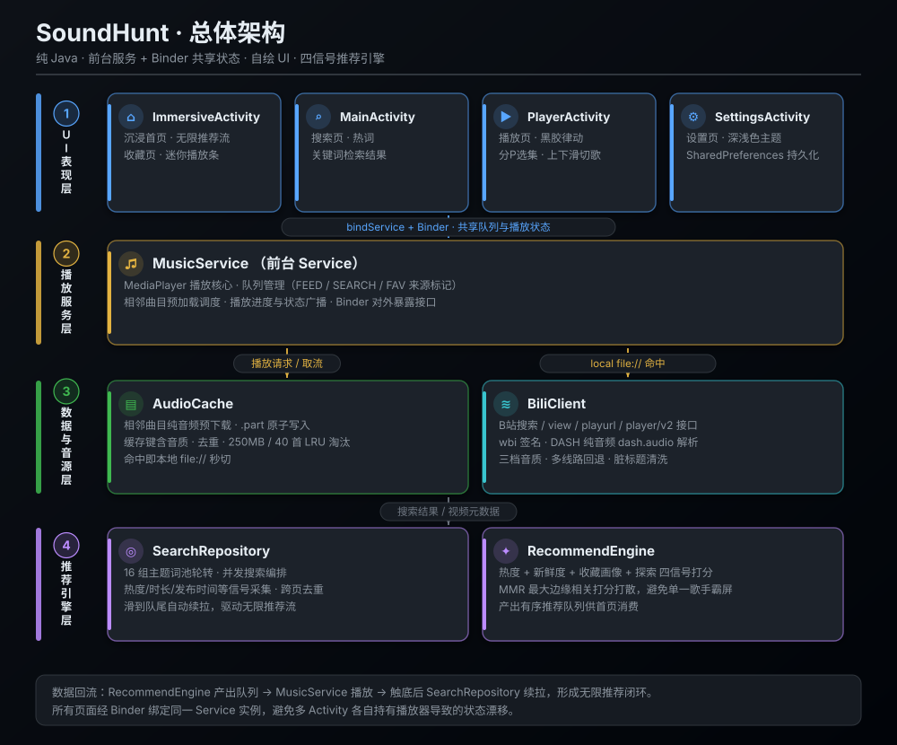

# SoundHunt 全平台推广文案包

> 基于 v3.2.7 真实功能与源码撰写，所有技术细节均可在仓库中核对。
> 项目地址：<https://github.com/SamislandHub/SoundHunt>
>
> ⚠️ **发布前必读 · 合规红线**
> 1. 全程定位为**个人学习 / 技术研究项目**，不包装成商业产品。
> 2. 禁用「破解、免费听付费歌曲、白嫖、盗版」等措辞。
> 3. 不鼓吹大规模抓取，不提供绕过平台风控的教程。
> 4. 每个平台的正文末尾都保留了免责声明（见第七节），务必带上。
> 5. 音源来自公开接口，可能随时失效，文案里不要做「永久可用」承诺。

---

## 目录

1. [统一素材库（标题 / 卖点 / 标签 / 截图）](#1-统一素材库)
2. [B 站视频脚本 + 分镜](#2-b-站视频脚本--分镜)
3. [掘金技术文章](#3-掘金技术文章)
4. [知乎问答（自问自答）](#4-知乎问答自问自答)
5. [酷安发帖](#5-酷安发帖)
6. [V2EX 发帖](#6-v2ex-发帖)
7. [小红书图文](#7-小红书图文)
8. [免责声明模板（各平台通用）](#8-免责声明模板各平台通用)
9. [发布节奏建议](#9-发布节奏建议)

---

## 1. 统一素材库

### 1.1 一句话卖点（按场景选）

| 场景 | 文案 |
|---|---|
| 给用户 | 像刷短视频一样听歌——打开就播，上下滑就切。 |
| 给开发者 | 一个纯 Java、全自绘 UI、带四信号推荐引擎的开源音乐播放器。 |
| 给极客 | 无广告、无付费、无第三方 UI 框架，音源接公开接口，代码全开源。 |
| 给 B 站用户 | 把你 B 站收藏的合集和音乐，变成一个能「刷」的播放器。 |

### 1.2 核心功能速记（写文案随时取用）

- 沉浸首页：启动自动播放推荐，上下滑切歌，轻点暂停/播放
- 黑胶唱片：Canvas 自绘，转速随音乐低频能量律动
- 推荐引擎：16 组主题词轮转 + 热度/新鲜度/收藏画像/探索四信号打分 + MMR 打散，治「一直推同一首」
- 无限续拉：滑到队尾自动拉下一批，跨页去重
- 音源音质：B 站公开接口 + wbi 签名 + DASH 纯音频流，三档音质（64K / 132K / 无损 FLAC）
- 秒切：后台预下载相邻曲目的纯音频到本地，命中即播，250MB / 40 首 LRU 淘汰
- 合集选集：长视频自动识别为合集，播放页展开分 P 列表
- 队列管理：搜索/收藏/推荐三类来源隔离，回首页自动恢复推荐流
- 收藏页：随机/顺序、按时间/歌名排序、悬浮迷你播放条
- 主题：墨黑 + 琥珀暖光，深浅色实时切换
- 工程：纯 Java、19 个类、无 XML 布局、无第三方 UI / 网络库

### 1.3 标题库

**B 站**
- 我把 B 站做成了一个「刷着听」的音乐 App（开源）
- 上下滑切歌的播放器，纯 Java 手搓了一个
- 用 B 站音源做了个音乐播放器，唱片会跟着鼓点转

**掘金**
- 从 0 手搓一个音乐推荐引擎：四信号打分 + MMR 打散，治好「单曲循环」
- 纯 Canvas 画一张会随节奏转的黑胶唱片（Android 自绘实战）
- 无第三方框架，我用 19 个 Java 类写了个沉浸式音乐播放器

**知乎**
- 如何评价开源的 SoundHunt：一个把 B 站变成沉浸式音乐播放器的项目？
- 有哪些「像刷短视频一样听歌」的开源 App？
- 自己写一个音乐推荐引擎，怎么避免一直推同一个歌手的歌？

**酷安 / V2EX**
- 【开源】小点声 SoundHunt：上下滑切歌的沉浸式音乐播放器
- Show HN 风格：SoundHunt — 一个纯 Java 自绘 UI 的 B 站音源播放器

**小红书**
- 我把听歌做成了刷短视频的感觉🎵
- 编码人自制音乐 App，唱片居然会跟着鼓点转

### 1.4 标签 / 话题

- 通用：`#开源 #Android #音乐播放器 #独立开发 #Java`
- B 站：`#开源项目 #Android开发 #音乐 #程序员 #B站`
- 掘金：`Android`、`Java`、`音视频`、`开源`、`推荐算法`
- 小红书：`#独立开发 #程序员日常 #app推荐 #音乐分享 #宝藏app`

### 1.5 截图素材（仓库内路径，发布时下载上传）

| 文件 | 内容 | 用途 |
|---|---|---|
| `docs/screens/real-home.jpg` | 沉浸首页 + 黑胶 + 底部 Tab | 首图 / 封面 |
| `docs/screens/real-search.jpg` | 搜索页 + 推荐列表 + 迷你条 | 功能展示 |
| `docs/screens/real-player.jpg` | 播放页 + 唱片 + 控制键 | 核心卖点 |
| `docs/screens/real-favorites.jpg` | 收藏页 + 随机/排序 | 功能展示 |
| `docs/architecture.svg` | 四层架构图 | 技术文章配图 |

---

## 2. B 站视频脚本 + 分镜

> 时长：约 90 秒 ｜ 形式：手机录屏 + 后期配音/字幕 ｜ 封面用 `real-home.jpg` 加粗体大字

**标题**：我把 B 站做成了一个「刷着听」的音乐 App（全程开源）
**简介**：一个纯 Java 手搓的沉浸式音乐播放器，打开就播、上下滑切歌，唱片还会跟着鼓点转。项目开源在 GitHub，链接放在简介第一条。仅用于技术研究，音源来自公开接口。

### 分镜表

| 时间 | 画面 | 口播 / 字幕 |
|---|---|---|
| 0:00–0:06 | 首页启动，直接开播，唱片转动 | 「打开就播，不用点。上下一滑——就切歌了。」 |
| 0:06–0:15 | 连续上滑 3 次切歌 | 「像刷短视频一样听歌，这是我做这个 App 的初衷。」 |
| 0:15–0:24 | 特写唱片，鼓点驱动转速变化 | 「这张黑胶是纯 Canvas 画的，转速跟着音乐低频走，鼓点越密转得越快。」 |
| 0:24–0:36 | 点进播放页，展开合集选集 | 「B 站的合集会自动识别成分 P 列表，想听哪一集点哪一集。」 |
| 0:36–0:48 | 播放页三点菜单切音质 | 「音质三档可切：64K、132K，还有无损。切歌是秒切的，因为相邻两首已经提前缓存成纯音频了。」 |
| 0:48–1:00 | 搜索页搜歌 → 返回首页 | 「搜歌、收藏都做了队列隔离，从任何页面回首页，都会恢复成推荐流。」 |
| 1:00–1:10 | 收藏页随机/排序 + 迷你条 | 「收藏页能随机、能排序，底部还有个迷你播放条。」 |
| 1:10–1:20 | 设置页切深浅色 | 「深浅色主题实时切换，全部代码开源。」 |
| 1:20–1:30 | 定格 GitHub 仓库页 + 架构图一闪 | 「项目叫 SoundHunt，GitHub 搜得到，链接在简介。纯学习项目，欢迎 Star。」

### 封面文案

主标题：**把 B 站变成「刷着听」的音乐 App**
副标题：开源 · 纯 Java · 唱片跟鼓点转

---

## 3. 掘金技术文章

> 标题：**从 0 手搓一个音乐推荐引擎：四信号打分 + MMR 打散，治好「单曲循环」**
> 标签：Android / Java / 推荐算法 / 音视频 / 开源
> 配图：架构图 + 首页截图 + 播放页截图

### 正文

#### 开篇

很多音乐 App 的「推荐」有个通病：听什么就一直推什么，两屏下来全是同一个歌手。我做的开源项目 SoundHunt 里，专门设计了一套**不依赖任何外部依赖、纯 Java 实现**的推荐引擎来解决这个问题。这篇文章拆解它的打分和打散逻辑。

先看整体架构（四层，UI → 播放服务 → 数据音源 → 推荐引擎）：



#### 一、四个信号，而不是「播放量排序」

直观做法是按热度排序，但那样只会让最火的歌永远排前面。我用了四个信号加权：

| 信号 | 权重 | 作用 |
|---|---|---|
| 热度 | 0.45 | 播放/点赞/收藏/弹幕取对数后加权，衡量大众认可度 |
| 新鲜度 | 0.15 | 发布时间越近略有加成，2 年内从 1 衰减到 0.3，不碾压经典 |
| 画像 | 0.45 | 从你的收藏提取偏好歌手/标签/关键词，命中加分 |
| 探索 | 随机项 | 少量随机，给冷门好歌机会，避免信息茧房 |

热度用对数归一化，避免一首千万播放的神曲把其他全部碾压：

```java
private static float logNorm(long value, long reference) {
    if (value <= 0) return 0f;
    double r = Math.log10(value + 1) / Math.log10(reference + 1);
    return (float) clamp01(r);
}

private float heatScore(Track t) {
    float p = logNorm(t.playCount, 20_000_000L);
    float l = logNorm(t.likeCount, 500_000L);
    float f = logNorm(t.favoriteCount, 300_000L);
    float d = logNorm(t.danmakuCount, 1_000_000L);
    return clamp01(p * 0.40f + l * 0.28f + f * 0.20f + d * 0.12f);
}
```

画像分从收藏里统计偏好，并归一化到 0~1，避免收藏很多时权重爆炸：

```java
public synchronized void buildProfile(List<Track> favorites) {
    artistTaste.clear(); tagTaste.clear(); keywordTaste.clear();
    if (favorites != null) {
        int n = 0;
        for (Track t : favorites) {
            if (t == null) continue;
            n++;
            if (notEmpty(t.artist)) bump(artistTaste, t.artist.toLowerCase(), 1.0f);
            if (notEmpty(t.tag))
                for (String tag : t.tag.split("\\s+")) bump(tagTaste, tag, 0.7f);
            for (String kw : keywords(t.title)) bump(keywordTaste, kw, 0.5f);
        }
        normalize(artistTaste, n); normalize(tagTaste, n); normalize(keywordTaste, n);
    }
}
```

#### 二、MMR 打散：相关但不重复

打分排完序还不算完——如果前 20 首都是周杰伦，体验依然很差。所以第二部用 **MMR（最大边际相关性）** 重排：每选一首，都惩罚与已选曲目「同歌手 / 同标签」的候选。

```java
while (selected.size() < want && !pool.isEmpty()) {
    Scored best = null;
    float bestMmr = -Float.MAX_VALUE;
    for (Scored s : pool) {
        float diversity = diversityPenalty(s, artistCount, tagCount);
        float mmr = s.total - LAMBDA * diversity;  // LAMBDA=0.85
        if (mmr > bestMmr) { bestMmr = mmr; best = s; }
    }
    selected.add(best);
    pool.remove(best);
    account(best.track, artistCount, tagCount);
}
```

多样性惩罚里，**同歌手是强惩罚（0.9 起步，重复一次加 0.3）**，同标签是中等惩罚：

```java
private float diversityPenalty(Scored s, Map<String,Integer> artistCount,
                               Map<String,Integer> tagCount) {
    float penalty = 0f;
    String artist = s.track.artist == null ? "" : s.track.artist.toLowerCase();
    if (!artist.isEmpty() && artistCount.containsKey(artist))
        penalty += 0.9f + 0.3f * artistCount.get(artist);   // 同歌手强惩罚
    if (notEmpty(s.track.tag)) {
        for (String tag : s.track.tag.split("\\s+")) {
            Integer c = tagCount.get(tag.toLowerCase());
            if (c != null) penalty += Math.min(0.5f, 0.15f * c);
        }
    }
    return penalty;
}
```

这样一条流里风格会强制轮换，从机制上避免「一直是某个歌手的歌」。

#### 三、配合工程侧的三个细节

1. **主题词轮转**：16 组主题词轮流并发搜索，候选池本身就有多样性，不给单一来源垄断的机会。
2. **跨页去重**：会话内维护 `sessionSeen` 集合，续拉时跳过已推过的 `stableId`。
3. **合集降权**：合集（长连播）在打分里有 0.35 的惩罚项，优先保证单曲体验。

#### 写在最后

这套引擎总共 280 行 Java，没有引入任何推荐框架，效果却比「按热度排序」好得多。核心思路就两条：**多信号打分避免单一维度**，**MMR 重排强制多样性**。

项目开源在 <https://github.com/SamislandHub/SoundHunt>，欢迎 Star 和提 issue。

> 免责声明：本项目仅用于个人学习与技术研究，音源来自公开接口，作者与版权方无关联，请勿用于商业或侵权用途。详见仓库 README。

---

## 4. 知乎问答（自问自答）

### 问题

**有哪些「像刷短视频一样听歌」的开源音乐 App？**

### 回答

推荐一个我自己写的开源项目 **SoundHunt**（小点声），思路就是「把听歌做成刷短视频」：打开自动播推荐，上下滑切歌，轻点暂停。GitHub 搜 SoundHunt 能找到。

几个我觉得有意思的点：

**1. 交互**
沉浸首页全屏一张黑胶唱片，上下滑切歌。唱片是 Canvas 手绘的，转速会跟着音乐的低频能量变化——鼓点密的时候转得快，暂停时缓缓停下。这个细节让「听歌」多了点仪式感。

**2. 推荐不是瞎推**
没有用固定歌单，而是四信号打分：热度、新鲜度、你的收藏画像、还有一点随机探索。打完分再用 MMR 算法打散，所以不会连着给你推同一个歌手的歌。你收藏得越多，它越懂你。

**3. 切歌是秒切的**
后台会提前把上一首和下一首的**纯音频轨**下载到本地缓存（只下音频不下视频），切歌命中缓存直接播。缓存上限 250MB / 40 首，LRU 淘汰，不会撑爆存储。

**4. 音源与音质**
音源接的是公开接口，支持标准 64K / 高清 132K / 无损 FLAC 三档（无损通常需要登录）。B 站的合集会自动识别成分 P 列表，在播放页选集播放。

**5. 工程上比较「干净」**
纯 Java 写的，UI 全部代码构建，没有 XML 布局，也没有第三方 UI 框架和网络库。19 个类，想学 Android 自绘 View 的话代码挺好读。

**适合谁**：想找个无广告、能折腾、源码能读的播放器的朋友；或者想学 Android 自绘 / 推荐算法的开发者。

**老实说的局限**：音源依赖公开接口，接口一变就可能失效，这点没法保证长期稳定；歌词没做（B 站字幕对音乐视频覆盖率太低，第三方曲库时间轴对不上，就放弃了）。

> 免责声明：项目仅用于个人学习与技术研究，不包含任何音频内容，音源来自公开接口，与版权方无关联，请勿用于商业或侵权用途。

---

## 5. 酷安发帖

> 板块：应用分享 ｜ 标题：**【开源】小点声 SoundHunt：上下滑切歌的沉浸式音乐播放器**

**正文：**

酷友分享一个自己写的开源播放器，安卓端，纯学习项目。

**它是什么**
打开就播推荐音乐，上下滑切歌，像刷短视频一样听歌。全屏一张黑胶唱片，转速跟着鼓点走。

**几个亮点**
- 🎵 推荐不重复：四信号打分 + MMR 打散，不会一直推同一个歌手；收藏越多越懂你
- ⚡ 秒切：提前缓存相邻两首的纯音频到本地，切歌命中直接播
- 📀 合集选集：B 站合集自动识别成分 P 列表
- 🎚 三档音质：64K / 132K / 无损 FLAC
- 🌗 深浅色主题实时切换，墨黑 + 琥珀配色
- 🧹 干净：无广告、无登录、无第三方 UI 框架，代码全开源

**关于音源**
接的是公开接口，不包含任何音频内容。接口可能变动，不保证永久可用——这点先说清楚。

**适不适合你**
想要无广告、能折腾、源码可读的播放器可以试试；介意音源稳定性的慎入。

GitHub 搜 **SoundHunt**，Release 里有签名 APK，README 有真机截图。欢迎 Star 和反馈。

> 本项目仅用于个人学习与技术研究，音源来自公开接口，与版权方无关联，请勿用于商业或侵权用途。

---

## 6. V2EX 发帖

> 节点：展示创意（create） ｜ 标题：**SoundHunt：一个纯 Java 自绘 UI、上下滑切歌的开源音乐播放器**

**正文：**

各位 V 友，分享一个业余时间做的开源项目 SoundHunt，一个沉浸式音乐播放器。

**动机**：想做一个「打开就播、上下滑切歌」的听歌方式，同时不想引入任何音乐版权库，音源走公开接口。

**技术上的几个取舍**：
- UI 全部用 `new View()` + Canvas 自绘，不用 XML 布局，也没有任何第三方 UI / 网络库（HttpURLConnection + org.json 足矣）。目前 19 个类。
- 黑胶唱片的转速用 `Visualizer` 读 FFT 低频能量驱动，能量上升快、回落慢，鼓点推得动又不抖；某些机型采不到频谱时有节拍脉冲兜底。
- 推荐引擎是自写的四信号打分（热度/新鲜度/收藏画像/探索）+ MMR 打散，解决「一直推同一首」的问题。
- 相邻曲目预下载纯音频轨到本地，命中即秒切；250MB / 40 首 LRU。

**已知问题**：音源依赖公开接口，稳定性无法保证；歌词没做（字幕覆盖率太低）。

代码在 <https://github.com/SamislandHub/SoundHunt>，MIT 协议。欢迎拍砖，尤其想听听大家对推荐打散和自绘性能方面的意见。

> 项目仅用于个人学习与技术研究，音源来自公开接口，与版权方无关联。

---

## 7. 小红书图文

> 封面：用 `real-home.jpg`，加大字「听歌也能像刷短视频？」
> 篇幅：6 图，正文控制在 300 字内，多表情符号

**标题**：听歌也能像刷短视频？我自制了个宝藏 App 🎵

**正文：**

谁懂啊，把听歌做成刷短视频的感觉真的会上瘾😭

自己写了个音乐 App，打开就直接开播，往上一滑就切下一首，完全不用点来点去～

最让我喜欢的是那张黑胶唱片💿 是代码一笔一笔画出来的，转速居然会跟着音乐的鼓点变化，鼓点越密转得越快，暂停时还会慢慢停下来，仪式感拉满✨

而且它懂我🎯 会根据我收藏的歌调整推荐，不会一直循环同一个歌手。想听合集的话能直接展开分 P 选集。切歌也是秒切，因为提前把下一首的纯音频存本地了⚡

深浅色主题都能切，墨黑配琥珀色真的高级感满满🖤

纯开源项目，无广告无付费，源码都能看。感兴趣的姐妹去 GitHub 搜 SoundHunt～

⚠️ 小提醒：音源走的是公开接口，不保证一直稳定，当个学习项目看就好。

#独立开发 #程序员日常 #app推荐 #音乐分享 #宝藏app #开源

---

## 8. 免责声明模板（各平台通用）

> 发布时按平台微调，核心信息不能少。

**标准版（B站 / 知乎 / 掘金）**

> 本项目仅用于个人学习与技术研究，是一个技术演示性质的开源项目。App 不包含、不存储、不分发任何音频内容，所有媒体均通过第三方公开接口在线获取；作者与相关平台及版权方无任何关联或授权关系。请勿用于商业用途或任何侵犯版权的行为，由此产生的责任由使用者自行承担。

**精简版（酷安 / V2EX / 小红书）**

> 仅用于个人学习与技术研究，音源来自公开接口，与版权方无关联，请勿用于商业或侵权用途。详见仓库 README 免责声明。

---

## 9. 发布节奏建议

| 阶段 | 动作 | 目的 |
|---|---|---|
| 第 1 天 | GitHub 仓库整理好（README / 截图 / 架构图 / Release APK 齐备） | 准备好落地页，所有流量都往这里导 |
| 第 2 天 | 发 B 站视频 + 酷安帖 | 视频最直观，酷安带来第一批安卓用户 |
| 第 3–4 天 | 发掘金技术文 + V2EX | 建立技术口碑，收开发者反馈和 Star |
| 第 5–7 天 | 知乎自问自答 + 小红书图文 | 扩圈到普通用户 |
| 持续 | 根据 issue 修 bug，版本更新后在各帖补充更新日志 | 保持热度，积累口碑 |

**小技巧**
- 所有平台简介/正文第一条都放同一个 GitHub 链接，方便统计来源（可用带参数的短链区分渠道）。
- B 站视频发布于晚 8–10 点，技术文发于工作日上午，小红书发于午休/睡前。
- 有人反馈 bug 时优先在 GitHub issue 回复，公开解决问题本身就是最好的「作品集」。

---

*文案包版本：v1.0 · 对应 SoundHunt v3.2.7 · 生成于 2026-11-21*
